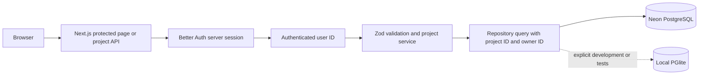

# Phase 0 architecture

UGCPROMAX Studio starts as a modular monolith. Next.js App Router provides pages and server route handlers. The project domain validates commands and performs owner-scoped persistence through Drizzle. Better Auth manages identity and cookie-backed sessions. Neon PostgreSQL is the production store; PGlite is an explicit local development/test store using the same schema and migrations.

## Module boundaries

| Layer | Responsibility | Boundary |
| --- | --- | --- |
| `src/app` | Routing, protected server pages, project API, loading/error states | Calls authentication/domain modules; does not own persistence rules |
| `src/components` | Accessible forms, navigation, project presentation, UI primitives | Sends supported commands; never supplies trusted ownership |
| `src/lib` | Server environment validation and HTTP helpers | Secrets stay server-side |
| `src/modules/auth` | Better Auth server/client configuration and session resolution | Cookie presence alone is not authentication |
| `src/modules/projects` | Zod schemas, service commands, typed errors, owner-scoped repository | No provider, workflow, or media dependencies |
| `src/db` | PostgreSQL schema, selected driver, migration runner | Database access is server-only |
| `drizzle` | Versioned generated SQL and migration metadata | Applied deliberately to Neon and automatically during explicit local database initialization |
| `tests`, `e2e` | Domain/persistence checks and complete user journeys | Isolated local data; no paid integration calls |

The [Next.js route conventions](https://nextjs.org/docs/app/getting-started/project-structure) support pages, shared layouts, and route handlers while keeping domain modules outside routing files. Future provider adapters, durable workflows, storage, QC, rendering, and accounting will be introduced only in their phases.

## Request and ownership flow

Unauthenticated server pages redirect to sign-in. Project APIs reject unauthenticated requests. Every project query is scoped by the authenticated user ID. Reads, edits, and deletes use both owner and project ID; another user's ID produces the same not-found behavior as an absent project. Project ownership is immutable through the public API. This is application-level tenant isolation; it does not claim database row-level security is configured.

Mutations require an `Origin` matching `BETTER_AUTH_URL`. JSON mutation bodies are bounded to 16 KiB. Authentication throttling uses database-backed state, so an application restart does not clear the counters. Configured limits are 100/minute for general auth requests, 10/minute for sign-in, and 5/minute for sign-up per Better Auth key. Deployment must supply a trustworthy client-IP header through the hosting proxy; local dev may not provide that header. Production origins must use HTTPS.

Protected requests resolve the actual session server-side rather than treating cookie presence as proof of login. Better Auth owns cookie issuance, password hashing, session expiry, and auth endpoint behavior. Use its [Next.js handler integration](https://better-auth.com/docs/integrations/next), [Drizzle adapter](https://better-auth.com/docs/adapters/drizzle), and [email/password flow](https://better-auth.com/docs/authentication/email-password). Password minimum length is 12. Email delivery and verification are deferred and must be addressed before a broad public launch.

## Database schema

The Phase 0 domain contains only `projects`. Better Auth's required identity, session, account, verification, and rate-limit storage are infrastructure tables. UUIDs identify users and projects; timestamps use time zones. Binary media is not stored in PostgreSQL.

| Table | Purpose and constraints |
| --- | --- |
| `user` | UUID identity, name, unique email, verification flag, optional image, timestamps |
| `session` | Unique token, expiry, user FK, timestamps, optional IP/user-agent; indexed user FK |
| `account` | Provider/account identity, password hash or provider credentials, user FK; unique provider/account pair |
| `verification` | Better Auth verification tokens and expiry; indexed identifier |
| `rate_limit` | Better Auth's persistent authentication throttling state |
| `projects` | Owner user FK, draft setup metadata, timestamps; ownership/listing index and DB checks |

Better Auth tables use its required property names mapped to SQL snake case. User deletion cascades to owned identity records and projects. The schema in `src/db/schema.ts` is authoritative.

| Project field | Constraint/default |
| --- | --- |
| `id` | Generated UUID primary key |
| `ownerId` | Required user UUID foreign key; derived from server session |
| `name` | Trimmed, 1–100 characters; nonblank DB check |
| `productUrl` | Optional/null, at most 2,048 characters, HTTP or HTTPS, no embedded username/password |
| `country` | `MA`, initially the sole supported country |
| `language` | `ary-MA`, initially the sole supported locale |
| `durationSeconds` | 16, 24, or 32; default 24 |
| `marketingAngle` | Optional/null, at most 1,000 characters |
| `status` | `draft`; not client-editable |
| `createdAt`, `updatedAt` | Required time-zone-aware timestamps |

Zod rejects unknown submitted fields. Partial updates require at least one editable field. List pagination is bounded: page 1–10,000 and page size 1–50, default 12. Database checks repeat the supported market/language/duration and nonblank name invariants. URL validation is input hygiene only: Phase 0 never fetches the submitted URL, and it does not claim to implement Phase 1 SSRF defenses.

## Database drivers and migrations

`DATABASE_DRIVER=neon` selects the Neon driver and requires a real connection string. `DATABASE_DRIVER=pglite` explicitly selects local PostgreSQL-compatible persistence; there is no fallback after a Neon connection failure. Production rejects PGlite. `LOCAL_DATABASE_PATH` controls its data directory.

Neon uses the documented [Drizzle Neon integration](https://orm.drizzle.team/docs/connect-neon). Local persistence uses the documented [Drizzle PGlite integration](https://orm.drizzle.team/docs/connect-pglite). PGlite is suitable for one local process, not a serverless deployment or shared multi-instance data store. Live Neon behavior remains unverified until supplied credentials allow migration and a smoke test.

The committed SQL migrations are applied by `pnpm db:migrate`. Local database initialization applies them before the first database operation. Schema changes require generation and review of a new migration; do not rewrite an applied migration or use destructive schema resets. A migration against the owner's Neon database is an external operation requiring an intentionally configured database.

## Errors and UI state

Project API successes use a `data` envelope. Errors use `error.code` and `error.message`, with optional field errors. Invalid editable fields produce 422, malformed JSON 400, missing sessions 401, rejected origins 403, inaccessible/missing projects 404, oversized bodies 413, and unsupported content types 415. Internal errors do not expose database details. Better Auth endpoints retain their own response format.

The dashboard lists persisted projects. Project creation and editing show server validation and useful pending/error states. Deletion is deliberate and returns to the list. Future generation controls remain disabled with an explanation. A saved project is always a draft, never a simulated completed video. Credits, usage, extraction, clips, and renders are not fabricated.

## Validation and operational limits

Vitest covers domain constraints and actual database ownership behavior. Playwright covers registration, sign-in/out, draft CRUD, persistence, unauthenticated rejection, and two-user isolation. Standard checks also include strict TypeScript, lint, and production build. Test results must state which driver was exercised.

This is the foundation milestone, not an assertion of complete production readiness. Neon deployment smoke testing, account recovery/email verification, production monitoring/backup policy, and later-phase SSRF/upload/webhook/spending controls are separate work. No AI Gateway, Trigger.dev, R2, Remotion, model registry, generation job state machine, or billing schema is present in Phase 0.

See `docs/DECISIONS.md` for the rationale and `docs/ROADMAP.md` for the phase boundary.
